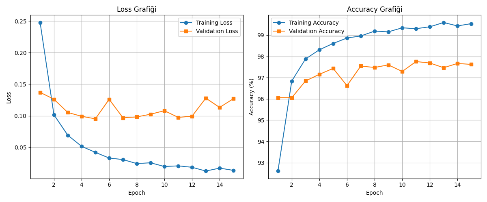
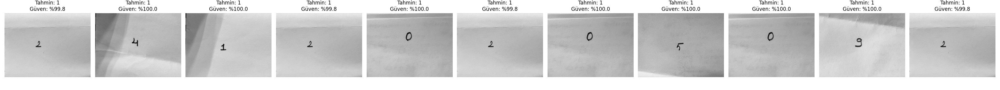

# ÖDEV: MNIST Veri Seti ile MLP Tabanlı El Yazısı Rakam Tanıma

Bu projede PyTorch kullanılarak Multi-Layer Perceptron (MLP) mimarisi ile MNIST el yazısı rakam tanıma modeli sıfırdan eğitilmiş, hiperparametre sonuçları analiz edilmiş ve gerçek hayattaki el yazısı üzerindeki performansı (Distribution Shift) değerlendirilmiştir.

## 1. Model Mimarisi ve Hiperparametreler
- **Model Tipi:** Multi-Layer Perceptron (MLP - Fully Connected)
- **Girdi Boyutu:** 784 (28x28 piksel)
- **Gizli Katmanlar:** 2 Hidden Layer (256 ve 128 nöron, ReLU aktivasyonu)
- **Çıkış Katmanı:** 10 Nöron (0-9 rakam sınıfları)
- **Loss Fonksiyonu:** CrossEntropyLoss
- **Optimizer:** Adam (Learning Rate: 0.001)
- **Batch Size:** 64
- **Epoch Sayısı:** 15

## 2. Veri Seti Ayrımı (Train / Validation / Test)
- **Training Set (%85):** 51,000 görüntü
- **Validation Set (%15):** 9,000 görüntü
- **Test Set:** 10,000 görüntü (Model eğitiminde kullanılmamıştır)

## 3. Deney Sonuçları ve Metrikler
- **Eğitim Süresi:** ~277 saniye (CPU)
- **Training Loss:** 0.0135 | **Training Accuracy:** %99.54
- **Validation Loss:** 0.1271 | **Validation Accuracy:** %97.62
- **Test Loss:** 0.1078 | **Test Accuracy:** %97.85

### Loss ve Accuracy Grafikleri

## 4. Kendi El Yazısı Görüntülerinin Değerlendirilmesi
Okul numarama (24120205092) ait rakamlar kâğıda yazılıp fotoğraflanmış, 28x28 gri tonlamalı formatta normalize edilerek modele sunulmuştur.

### Değerlendirme ve Distribution Shift Analizi
- **Bulgular:** Model standart MNIST test setinde **%97.85** gibi yüksek bir başarı yakalamış olmasına rağmen, kendi el yazımla hazırladığım fotoğraflarda tüm rakamları "1" olarak tahmin etmiştir.
- **Nedeni (Dağılım Kayması / Distribution Shift):**
  1. **Spatial Özelliklerin Kaybı:** MLP mimarisi görüntüdeki mekânsal (2D) ilişkileri koruyamaz, pikselleri 784 elemanlı düz bir vektöre dönüştürür.
  2. **Piksel Silikleşmesi ve Arka Plan Gürültüsü:** Fotoğraflardaki rakam çizgileri 28x28 boyutuna indirgenirken silikleşmiş; kağıttaki ışık ve gölgeler model tarafından MNIST'teki "1" yapısına benzetilmiştir.
  3. **Generalization (Genelleştirme):** Temiz MNIST verisinde eğitilen model, gerçek dünya verisindeki gürültüye adapte olamamıştır.
